# RaceDay System - Entity Relationship Diagram (ERD)

## Overview
This ERD models the core data for the RaceDay event management platform supporting South African road running, walking and cycling events.

**Minimum 6 entities implemented:** Roles, Users, Events, Categories, Enrolments, Results.

## Entity Relationship Diagram (Mermaid)

```mermaid
erDiagram
    ROLES ||--o{ USERS : "has"
    USERS ||--o{ EVENTS : "organises"
    USERS ||--o{ ENROLMENTS : "registers"
    USERS ||--o{ RESULTS : "captures"
    EVENTS ||--o{ CATEGORIES : "has"
    CATEGORIES ||--o{ ENROLMENTS : "has"
    ENROLMENTS ||--o| RESULTS : "has"

    ROLES {
        int RoleId PK
        nvarchar RoleName UK
        nvarchar Description
    }

    USERS {
        int UserId PK
        int RoleId FK
        nvarchar FirstName
        nvarchar LastName
        nvarchar Email UK
        nvarchar PasswordHash
        nvarchar PhoneNumber
        date DateOfBirth
        datetime2 CreatedAt
        bit IsActive
    }

    EVENTS {
        int EventId PK
        int OrganiserId FK
        nvarchar Title
        nvarchar Description
        date EventDate
        time StartTime
        nvarchar Location
        nvarchar City
        nvarchar Province
        nvarchar Status
        int MaxParticipants
        nvarchar ImageUrl
        datetime2 CreatedAt
        datetime2 UpdatedAt
    }

    CATEGORIES {
        int CategoryId PK
        int EventId FK
        nvarchar Name
        decimal DistanceKm
        decimal EntryFee
        int AgeMin
        int AgeMax
        nvarchar GenderRestriction
        int MaxEntries
        datetime2 CreatedAt
    }

    ENROLMENTS {
        int EnrolmentId PK
        int ParticipantId FK
        int CategoryId FK
        datetime2 EnrolmentDate
        nvarchar Status
        nvarchar BibNumber
        nvarchar PaymentStatus
        nvarchar Notes
    }

    RESULTS {
        int ResultId PK
        int EnrolmentId FK
        time FinishTime
        int OverallPosition
        int CategoryPosition
        nvarchar Status
        time ChipTime
        time GunTime
        datetime2 CapturedAt
        int CapturedByUserId FK
    }
```

## Cardinality Summary

| Relationship              | Type          | Description                                      |
|---------------------------|---------------|--------------------------------------------------|
| Roles → Users             | One-to-Many   | Each role can be assigned to many users          |
| Users → Events            | One-to-Many   | An Organiser can create many events              |
| Events → Categories       | One-to-Many   | An event has multiple distance/age categories    |
| Users → Enrolments        | One-to-Many   | A Participant can enrol in many categories       |
| Categories → Enrolments   | One-to-Many   | A category can have many enrolments              |
| Enrolments → Results      | One-to-One    | Each completed enrolment has at most one result  |
| Users → Results           | One-to-Many   | An Organiser can capture many results            |

## Primary Keys, Foreign Keys & Constraints

- **Roles.RoleId** (PK), **RoleName** UNIQUE NOT NULL
- **Users.UserId** (PK), **RoleId** FK → Roles, **Email** UNIQUE NOT NULL
- **Events.EventId** (PK), **OrganiserId** FK → Users (must be Organiser role)
- **Categories.CategoryId** (PK), **EventId** FK → Events ON DELETE CASCADE
- **Enrolments.EnrolmentId** (PK), **ParticipantId** FK → Users, **CategoryId** FK → Categories
  - UNIQUE (ParticipantId, CategoryId) – a participant cannot enrol twice in the same category
- **Results.ResultId** (PK), **EnrolmentId** FK → Enrolments UNIQUE, **CapturedByUserId** FK → Users

## Design Decisions

1. **Roles table** – Explicit roles table allows easy extension (e.g. Admin later) and enforces referential integrity.
2. **Single Organiser per Event** – Matches the requirement that organisers create and manage their own events. Can be extended to many-to-many later if needed.
3. **Categories belong to Events** – Typical for road races (5km, 10km, 21.1km, 42.2km under one event).
4. **Enrolment links Participant + Category** – Allows a participant to enter multiple categories of the same event if rules permit.
5. **One-to-One Results** – Results are captured against a specific enrolment; FinishTime and positions stored here.
6. **Status fields** – String-based for simplicity in Part 1; can be converted to lookup tables in future iterations.
7. **ImageUrl** – Prepared for Azure Blob Storage integration in Part 3.
8. **No soft-delete flags** – Hard deletes with cascade where appropriate; business rules enforced at API level.

## Notes for Implementation (Part 2+)
- Password hashing will use ASP.NET Identity or BCrypt in the API.
- Role checks enforced via JWT claims / Authorize attributes.
- The SQL script in `RaceDay_Database.sql` matches this ERD exactly.
